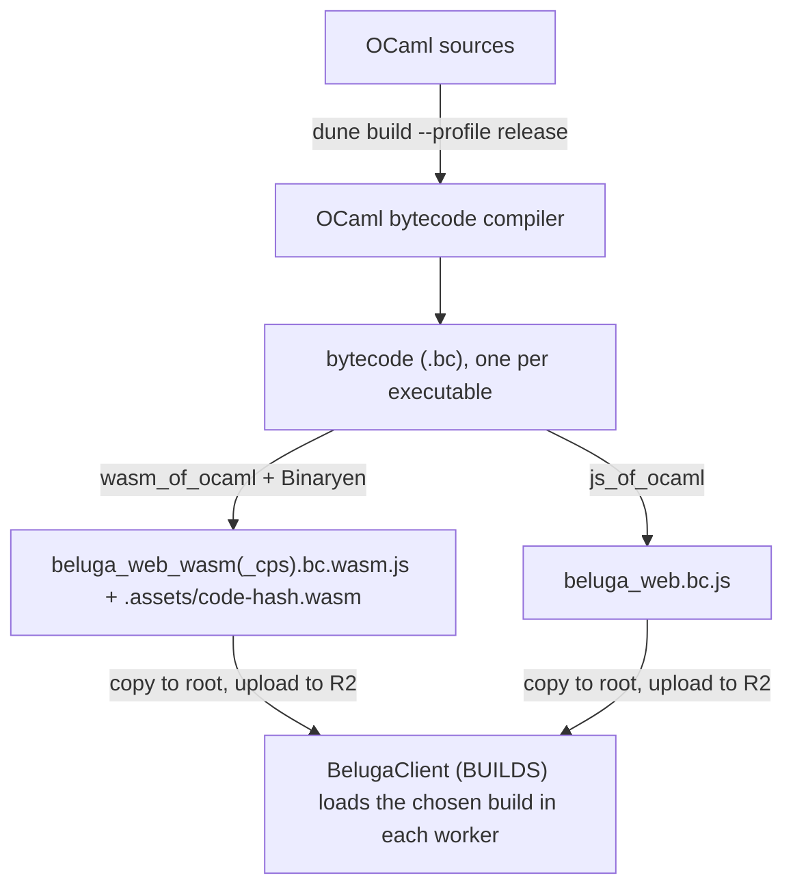
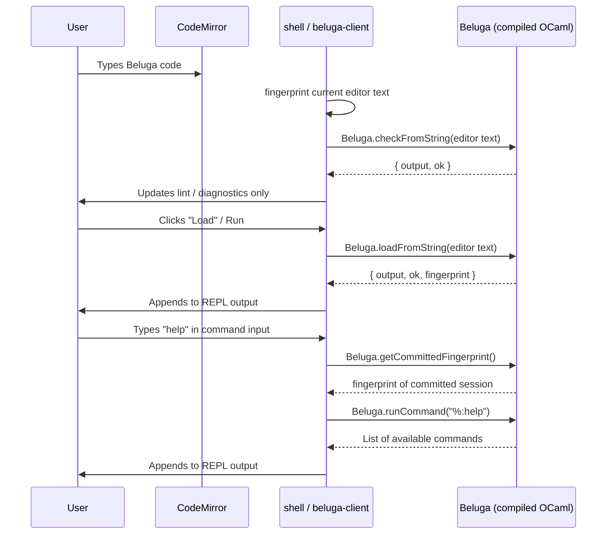

### Key Entry Points

| Function | What it does |
|---|---|
| `Load.load_fresh filename` | Reads `.cfg`/`.bel` from disk, runs full pipeline |
| `Command.create_initial_state ()` | Creates REPL state (used by Harpoon/emacs) |
| `Command.interpret_command state ~input` | Processes a `%:command` in the REPL |
| `Chatter.print lvl f` | Emits compiler diagnostic messages |

### What Breaks on Web

1. **No filesystem** — `Load.load_fresh` opens files via `In_channel`. Browser has no `open_in`.
2. **Hardcoded stdout** — `Chatter.print` writes to `Format.std_formatter`. No way to capture output.
3. **Blocking prompt** — `Logic.ml` calls `read_line()` for "More solutions?" — blocks forever in JS.
4. **`Unix.times()`** — `Monitor.ml` uses this for timing. `js_of_ocaml`'s Unix stub throws (wasm_of_ocaml's loader implements `times`, so the Wasm builds do not need patch 6, but the JS build does).
5. **`Str` library** — `prettyint.ml` used `Str.regexp` (patch 8 takes it out). `Str` is still linked, though: `syncom/name.ml` calls `Str.regexp` / `Str.search_backward`, and `beluga_html` (which core links, below) uses it. Both js_of_ocaml and wasm_of_ocaml ship their own `Str` primitives, so this builds; it is not C-stub-free.
6. **Warning 53** — `js_of_ocaml-ppx` can trigger warning 53 (`misplaced-attribute`) on the web executable. Suppress with `-w -53` on `src/web/dune` only. Invalid `[@unboxed]` on `List1` / `List2` / `Synext_precedence` was removed for OCaml 5.4.

---

## Every Patch

### 1. Output redirection — `src/core/chatter.ml`

**Problem:** Output goes to stdout. Browser has no stdout.

**Full adapted file:**
```ocaml
open Support

let level : int ref = ref 1

let formatter : Format.formatter ref = ref Format.std_formatter

let set_formatter ppf = formatter := ppf

let print lvl f =
  if lvl <= !level
  then (f !formatter; Format.pp_print_flush !formatter ())
  else ()
```

The original hardcoded `Format.std_formatter`. Now it's a mutable ref — defaults to stdout (CLI unchanged), web swaps it for a `Buffer.t`-backed formatter.

---

### 2. Configurable formatter + string loading — `src/core/command.ml`

**Problem:** `create_initial_state` hardcodes `Format.std_formatter`; no way to load code from a string.

**Key changes** (in a 966-line file):

Line 154 — `ppf` is now a field in `state`:
```ocaml
type state =
  { ppf : Format.formatter
  ; commands : command String.Hashtbl.t
  (* ... rest unchanged ... *)
  }
```

Lines 403–408 — new `load_from_string` in `Make_interpreter_state`:
```ocaml
let load_from_string state ~virtual_filename ~content =
  let sgn =
    Load.load_from_string state.load_state ~virtual_filename ~content
  in
  state.last_load <- Option.none;
  sgn
```

Lines 937–952 — `create_initial_state` now takes optional `ppf`:
```ocaml
let create_initial_state ?(ppf = Format.std_formatter) () =
  Chatter.set_formatter ppf;
  (* ... creates disambiguation/indexing/reconstruction states ... *)
  let state =
    Interpreter_state.create_state ppf disambiguation_state
      indexing_state signature_reconstruction_state
  in
  Interpreter.register_commands state;
  state
```

Lines 964–965 — top-level `load_from_string` delegate:
```ocaml
let load_from_string state ~virtual_filename ~content =
  Interpreter_state.load_from_string state ~virtual_filename ~content
```

---

### 3. Command interface — `src/core/command.mli`

**Full adapted file:**
```ocaml
type state

val fprintf : state -> ('a, Format.formatter, Unit.t) format -> 'a

val create_initial_state : ?ppf:Format.formatter -> Unit.t -> state

val print_usage : state -> Unit.t

val interpret_command : state -> input:String.t -> Unit.t

val load : state -> filename:String.t -> Synint.Sgn.sgn

val load_from_string :
  state -> virtual_filename:String.t -> content:String.t -> Synint.Sgn.sgn
```

Two changes from upstream: `?ppf` parameter on `create_initial_state`, and `load_from_string`.

---

### 4. String-based loading — `src/core/load.ml`

**Problem:** Beluga only loads from disk. We need to load from a raw string.

**Added to `LOAD_STATE` (lines 17–21):**
```ocaml
val read_signature_from_string :
  state ->
  virtual_filename:String.t ->
  content:String.t ->
  Synext.signature_file
```

**Implementation (lines 75–87):**
```ocaml
let read_signature_from_string state ~virtual_filename ~content =
  let signature_file =
    let initial_location = Location.initial virtual_filename in
    let token_sequence = Lexer.lex_string ~initial_location content in
    let parsing_state =
      Parser_state.initial ~initial_location token_sequence
    in
    Parser.Parsing.eval_exn
      Parser.Parsing.(only signature_file)
      parsing_state
  in
  Disambiguation.disambiguate_signature_file state.disambiguation_state
    signature_file
```

This mirrors `read_signature_file` exactly, but uses `Lexer.lex_string` instead of `Lexer.lex_input_channel`. `Lexer.lex_string` already existed in Beluga (used by the REPL) — it was just never wired up for full signature loading.

**`load_from_string` (lines 220–272):** Mirrors `load_file` exactly — same `Gensym.reset`, `Store.clear`, `Typeinfo.clear_all`, `Holes.clear`, same reconstruction + coverage + logic + leftover-var checks. Calls `read_signature_from_string` instead of `read_signature_file`.

**Convenience wrapper (lines 299–312):** `load_from_string_fresh` — creates fresh states, useful for standalone usage.

---

### 5. Load interface — `src/core/load.mli`

Three additions to the interface:

```ocaml
(* In LOAD_STATE *)
val read_signature_from_string :
  state -> virtual_filename:String.t -> content:String.t -> Synext.signature_file

(* In LOAD *)
val load_from_string :
  state -> virtual_filename:String.t -> content:String.t -> Synint.Sgn.sgn

(* Top-level convenience *)
val load_from_string_fresh :
  virtual_filename:string -> content:string -> Synint.Sgn.sgn
```

---

### 6. Safe Unix.times — `src/core/monitor.ml`

**Problem:** `Unix.times()` throws in `js_of_ocaml` (the JS build). wasm_of_ocaml implements it, so under Wasm the fallback below never runs.

**Added (lines 25–29):**
```ocaml
let safe_times () =
  try Unix.times ()
  with _ ->
    { Unix.tms_utime = 0.; tms_stime = 0.;
      tms_cutime = 0.; tms_cstime = 0. }
```

All usages of `Unix.times ()` in the file replaced with `safe_times ()`. Monitoring is optional anyway (controlled by `Monitor.on`), so zeroed values are fine.

---

### 7. Query output redirection + configurable prompt — `src/core/logic.ml` + `logic.mli`

**Problem 1:** `Frontend.solve` and `Printer.printQuery` write to `Format.std_formatter` (stdout) and `Printf.printf` directly, bypassing the `ppf` buffer captured by `beluga_web.ml`. Query results never appear in the REPL.

**Problem 2:** `read_line()` in `moreSolutions` blocks the JS event loop forever. `Options.more_solutions_prompt` was defined as a workaround ref but was never actually called.

**Added to Options:**
```ocaml
(* Formatter for query output; override in non-CLI contexts. *)
let output_formatter : Format.formatter ref = ref Format.std_formatter

let more_solutions_prompt : (unit -> bool) ref = ref (fun () ->
  fprintf !output_formatter "More? @?";
  match read_line () with
  | "y" | "Y" | ";" -> true
  | "q" | "Q" | _ -> false)
```

`more_solutions_prompt` now uses `!output_formatter` so the "More?" prompt also respects the output redirect.

**`Frontend.moreSolutions` simplified** to actually call the ref:
```ocaml
let moreSolutions () =
  !Options.more_solutions_prompt ()
```

**`Printer.printQuery`** updated to use `!Options.output_formatter`.

**`Frontend.solve.scInit`** and all status `printf`/`std_formatter` calls in `Frontend.solve` replaced with `fprintf !Options.output_formatter`.

**Exposed in logic.mli:**
```ocaml
module Options : sig
  val enableLogic : bool ref
  val output_formatter : Format.formatter ref
  val more_solutions_prompt : (unit -> bool) ref
end
```

Web sets the prompt ref at session creation:
```ocaml
Logic.Options.more_solutions_prompt := (fun () -> false);
```

---

### 8. Remove Str dependency — `src/core/prettyint.ml` + `src/core/dune`

**Problem (as first found):** `Str` uses C stubs, which neither js_of_ocaml nor wasm_of_ocaml compiles. Both turned out to ship their own `Str` primitives, and `Str` is still linked elsewhere (item 5 above); this patch only takes it out of `prettyint.ml`.

**prettyint.ml (lines 126–128):**
```ocaml
(* Was: let ident_regexp = Str.regexp {|[^"].*|} + Str.string_match *)
let is_name_syntactically_valid name =
  let s = Name.string_of_name name in
  String.length s > 0 && s.[0] <> '"'
```

**src/core/dune:** Removed `str` from the `(libraries ...)` list. `str` remains in `src/html/dune` and `src/syntax/syncom/dune`. ⚠ `beluga_html` IS linked into the web bundle: core lists it (`src/core/dune`) for `Load.read_signature_and_write_html`, which only the CLI's `--html` reaches. It brings `str`, `omd` and `uri` (and through `uri`, `bigstringaf`, whose one primitive wasm_of_ocaml lacks: see Wasm builds).

---

### 9. Fix html/dune install stanza — `src/html/dune`

**Added `(package beluga)` to the install stanza:**
```dune
(install
 (package beluga)
 (section share)
 (files beluga.css))
```

Without specifying the package, `dune build` may fail depending on the version.

---

### 10. Web build target — `src/web/dune` (NEW)

Three executables from the one shim (abridged; the file itself carries the comments):

```dune
; the JS build: the fallback where Wasm cannot run
(executable
 (name beluga_web)
 (modules beluga_web)
 (modes js)
 (libraries js_of_ocaml support beluga beluga_syntax beluga_parser harpoon_core)
 (js_of_ocaml
  (flags (:standard --disable use-js-string --effects=cps)))
 (flags (:standard -w -53))
 (preprocess (pps js_of_ocaml-ppx)))

; each Wasm build from its own copy of the shim (dune wants one module per executable)
(rule
 (target beluga_web_wasm_cps.ml)
 (deps beluga_web.ml)
 (action (copy %{deps} %{target})))

(executable
 (name beluga_web_wasm_cps)          ; and beluga_web_wasm, with --effects=disabled
 (modules beluga_web_wasm_cps)
 (modes wasm)
 (libraries js_of_ocaml support beluga beluga_syntax beluga_parser harpoon_core)
 (wasm_of_ocaml
  (compilation_mode whole_program)
  (sourcemap no)
  (flags (:standard --effects=cps)))
 (flags (:standard -w -53))
 (preprocess (pps js_of_ocaml-ppx)))
```

See [Wasm builds](#wasm-builds). The `(wasm_of_ocaml ...)` field needs `(lang dune 3.17)` in `Beluga-W/dune-project` (it was 3.7); the bump left the JS outputs byte-identical (checked 2026-10-16 from a `dune clean` with the cache off). The double-translation build (`beluga_web_dt`, BelJar's "Fast" mode, run on the main thread) was removed on 2026-10-16: a Wasm build in a worker is faster and never freezes the page.

> [!WARNING]
> `--disable use-js-string` is **required**. Without it, js_of_ocaml uses JS native strings, but Beluga's lexer and string handling depend on OCaml byte-sequence semantics. Unicode characters (`⊃`, `∧`, `∨`, `¬`, `⊤`) corrupt without this flag.

> [!NOTE]
> `-w -53` is scoped to `src/web/dune` (ppx on the executable). Do not suppress it globally — invalid attributes in libraries should be fixed in source (see item 6).

---

### 11. Web entry point — `src/web/beluga_web.ml` (NEW)

**Current shape (abridged):**
```ocaml
open Js_of_ocaml
open Beluga
open Beluga_syntax.Syncom

type session =
  { state : Command.state
  ; buf : Buffer.t
  ; ppf : Format.formatter
  ; scan_pos : int ref
  }

let fingerprint_content s = ...
let parse_meta_line line = ...
let report_progress phase state = ...
let scan_buffer_for_progress buf scan_pos = ...
let make_progress_formatter buf scan_pos = ...
let drain session = ...
let create () = ...
let normalize_exn e = ...
let load_from_string session content = ...
let run_command session input = ...
let make_check_result ~output ~ok = ...
let make_load_result ~output ~ok ~fingerprint = ...

let () =
  Printexc.record_backtrace true;
  let session = ref (create ()) in
  let committed_fingerprint = ref "" in
  Js.export "Beluga"
    (object%js
       method checkFromString content = ...
       method loadFromString content = ...
       method runCommand input = ...
       method getCommittedFingerprint = ...
       method reset = ...
    end)
```

This file ties everything together:
1. Creates a `Buffer.t` + custom progress-scanning `Format.formatter` (`make_progress_formatter`) that scans each flush for `## Phase begin/done:` markers and fires them to JS via `reportBelugaProgress`
2. Disables ANSI color codes in error output (`Error.disable_colored_output ()`) — otherwise Beluga's pretty-printer emits escape sequences that render as garbage in HTML
3. Disables the blocking prompt (`more_solutions_prompt := fun () -> false`)
4. Creates state with `~ppf` (patches 1–3)
5. Exports a split web API:
   - `Beluga.checkFromString(code)` returns `{ output, ok }` and never commits to the live REPL session
   - `Beluga.loadFromString(code)` returns `{ output, ok, fingerprint }` and commits only on success
   - `Beluga.runCommand(cmd)` runs against the committed session
   - `Beluga.getCommittedFingerprint()` reports what Beluga itself believes is currently loaded
   - `Beluga.reset()` resets both the session and the committed fingerprint
6. Exception handling: `normalize_exn` converts JS `RangeError` → OCaml `Stack_overflow` before printing, so on the JS build stack overflows produce a clean message ("Stack overflow") rather than a raw JS exception string; falls back to `Printexc.to_string` for anything else. On the Wasm builds no OCaml handler sees the engine's overflow, so `normalize_exn` never meets it: the overflow is thrown out of the call, and `js/beluga/beluga-worker.js` (`overflowAnswer`) answers it exactly as the JS build would ([Wasm builds](#wasm-builds))

> [!IMPORTANT]
> **Trial-session pattern in both `checkFromString` and `loadFromString`.** A failed load leaves Beluga's globally mutable state (`Store`, `Typeinfo`, `Holes`, reconstruction state) half-corrupted. Reusing that session for the next load would silently poison subsequent successes. So every web load/check call builds a *fresh* session via `create ()`, attempts the load on it, and only `loadFromString` commits the trial to the live `session` ref if it succeeded. `checkFromString` always discards the trial. This is the key split that keeps lint from poisoning REPL state.
>
> A fresh session is not enough on its own: some state is global to the whole runtime, not the session. So `load_from_string` also resets, before every load, the unification constraint store (`Unify.StdTrail.resetGlobalCnstrs`) and the logic engine's query queue (`Store.clear (); Logic.prepare ()`). A failed load used to leave a queued `--query` for the next load to run against the new store (2026-10-18, `tests/test-beluga-stale-query.mjs`).
>
> `load_from_string` therefore returns `(string * bool)` rather than just `string`: the buffer contents plus a success flag the caller uses to decide whether to commit. `loadFromString` also updates a Beluga-owned content fingerprint so JS can ask Beluga what is truly committed before running commands.

---

## Build Pipeline



Two stages: OCaml compiles to bytecode (`.bc`), then wasm_of_ocaml (the Wasm builds) or js_of_ocaml (the JS build) translates that bytecode. The `bc` in the filenames literally stands for **bytecode**. All Beluga warning/error settings apply during Stage 1 (normal OCaml compilation) — the second stage only sees the already-compiled bytecode.

The build scripts (`rebuild.ps1` / `rebuild.sh`) run `dune build --profile release` in `Beluga-W` for the three web targets, copy them to the project root, then stamp them (`stamp-runtime.ps1`; `rebuild.sh` does the same two stamps itself). Then they go to R2: [Deploying](#deploying).

**The release profile** (since 2026-10-16): whole program, minified, no source map. Until then the JS build was dune's dev profile: separately compiled, pretty-printed, with an inline base64 source map (11 MB of its 25.4 MB), and it checked 1.9× slower in Chrome. The answers are the same, byte for byte (`docs/wasm-runtime.md` §3). The JS build is now 2.6 MB, ~330 KB as R2 sends it.

---

## Wasm builds

BelJar's default runtime since 2026-10-16 is `beluga_web_wasm_cps`, where the browser can run Wasm; the JS build is the fallback, and Settings > Beluga > Build version chooses (Wasm CPS, Wasm direct, JS CPS; their ids, stored on each device, are `wasm-cps`, `wasm` and `stable`). Measured in [`docs/wasm-runtime.md`](../docs/wasm-runtime.md).

**Toolchain** (all four needed; versions as built 2026-10-16):

| Tool | Version | How |
|---|---|---|
| OCaml | 5.4.1 | the existing opam switch (`%LOCALAPPDATA%\opam\default`) |
| dune | 3.23.0 | existing; the project needs `(lang dune 3.17)` |
| js_of_ocaml-compiler | 6.3.2 | existing |
| wasm_of_ocaml-compiler | 6.3.2 | `opam install wasm_of_ocaml-compiler.6.3.2`: it requires `js_of_ocaml = version`, so pin it to the installed js_of_ocaml, or opam upgrades the JS compiler under the JS builds. Adds only itself and `conf-binaryen` |
| Binaryen | version_126 | `conf-binaryen` just runs `wasm-opt --version`, and Windows has no package: unpack the official `binaryen-version_126-x86_64-windows.tar.gz` (GitHub releases, check its `.sha256`) to `%LOCALAPPDATA%\binaryen\version_126\` (`rebuild.ps1` looks there; `BINARYEN_BIN` overrides). version_126 is the release wasm_of_ocaml 6.3.2's CI ran with (it takes the latest; 6.3.2 shipped 2026-02-15, version_126 is of 2026-02-13). ≥ 119 is the stated minimum |

**Outputs**, copied to the repo root by the rebuild scripts under dune's names (the loader names its folder, so they cannot be renamed apart):

```
beluga_web_wasm.bc.wasm.js            12 KB loader
beluga_web_wasm.bc.wasm.assets/code-<hash>.wasm      ~1.8 MB
beluga_web_wasm_cps.bc.wasm.js        12 KB loader
beluga_web_wasm_cps.bc.wasm.assets/code-<hash>.wasm  ~2.3 MB
```

The `.wasm` is named by its content hash, so it busts caches by itself; only the loader needs the `?v=` stamp. `.assetsignore` keeps all four out of the Worker upload (`tests/test-deploy-config.mjs`).

---

## Deploying

The runtime is served from R2 (bucket `beljar-runtime`, at `https://beljar-cdn.deanbarry.com/`, CORS for the site's origins), never by the Worker. After a rebuild, in this order:

1. **Upload to R2**: `npm run upload:runtime` (`scripts/upload-runtime.mjs`; `--dry-run` prints the wrangler commands without running them). It uploads what `js/beluga/beluga-client.js` `BUILDS` names, and the `.wasm` beside each loader, with the types a browser needs (`application/wasm` for the `.wasm`, which `instantiateStreaming` refuses otherwise; a year's cache, its name being its hash), then reads every file back through the CDN under the new stamp and compares its bytes. Deploy only once it says R2 holds this build.
2. **Deploy the site** (the Git build deploys a push to the repository's default branch).
3. **Check it**: `npm run probe:live`. Among the rest: the editor runs Wasm CPS from the CDN, R2 sends each runtime file with its type, the site's CORS header and compressed, and the service worker caches the loader and its `.wasm`.

⛔ R2 first. Deploy first and the new page asks for files R2 does not have yet (the Wasm loader 404s), or Cloudflare's edge caches the old bytes under the new URL until its TTL. Old objects (`beluga_web.bc.dt.js`, earlier `.wasm`) can stay: nothing asks for them.

**Effects.** Beluga performs none: nothing under `Beluga-W/src`, nor gen, extlib, sedlex or the js_of_ocaml library, uses `Effect`; `Stdlib.Effect` is linked only as part of the stdlib. So the main build is `--effects=disabled` (direct style, no JSPI, and so no Chrome-137-only requirement). The default, `jspi`, would buy nothing. The CPS build exists for stack depth alone: with Wasm tail calls a CPS continuation does not grow the stack.

**Link warning, harmless:** `Missing primitives: bigstringaf_blit_to_bytes`. It comes from `uri` (via `beluga_html`, above), whose only caller is the CLI's `--html` path; wasm_of_ocaml supplies a stub that raises.

**Differences from the JS builds that matter to anything loading them:**

- **A stack overflow escapes OCaml.** Under js_of_ocaml, `normalize_exn` turns the JS `RangeError` into `Stack_overflow` and `checkFromString` *returns* "Stack overflow". Under Wasm the engine's `RangeError: Maximum call stack size exceeded` is not caught by any OCaml handler: it is *thrown* out of `checkFromString`. The instance answers correctly afterwards (`differential.mjs`, step E).
- **Startup is asynchronous and silent.** The loader is an async function whose promise it drops; `Beluga` appears when OCaml's start assigns it (onto `globalThis`: the loader reads `globalThis.module.export`, sic). In Node, `vm.runInContext` returns that promise; a worker has to observe the assignment.
- **The loader finds its `.wasm` from `document.currentScript.src`**, which a worker has not got (it then fetches relative to the worker's own URL). In Node it reads them relative to `require.main.filename`, and it hooks `process.on('uncaughtException')`. `tests/_beluga-runtime.mjs` loads all four builds in Node behind one shape.
- **It needs WasmGC, tail calls and exception handling** (Chrome 119, Firefox 122, Safari 18.2, Node 22), and uses the JS String Builtins where present (`instantiateStreaming(…, { builtins: [...] })`).

---

## Frontend

[`edit.html`](../edit.html), the editor, boots the Beluga clients, the editor bundle, then the product shell (home, `index.html`, loads no Beluga):

`beluga-client.js` → `harpoon-client.js` → `editor-cm.bundle.js` → `shell.js`

`beluga-client.js` never runs Beluga on the page: each slot is a worker (`js/beluga/beluga-worker.js`) that loads the chosen build through `js/beluga/beluga-runtime-load.js` (see [`docs/CODEMAP.md`](../docs/CODEMAP.md)). Styles load via [`css/style.css`](../css/style.css) (import cascade).

### JS API

```javascript
Beluga.checkFromString(code)        // -> { output, ok }
Beluga.loadFromString(code)         // -> { output, ok, fingerprint }
Beluga.runCommand(cmd)              // -> string
Beluga.getCommittedFingerprint()    // -> string
Beluga.reset()                      // -> string ("Session reset.")
```

### Data Flow



The command input auto-prepends `%:` so users can type `help` instead of `%:help`.

---

## Upstream Reintegration Checklist

When Beluga updates upstream, re-apply these 13 patches in order:

| # | File(s) | Type | Description |
|---|---|---|---|
| 1 | `src/core/chatter.ml` | **Modify** | Add `formatter` ref + `set_formatter` |
| 2 | `src/core/command.ml` | **Modify** | Add `?ppf` to `create_initial_state`, add `load_from_string` |
| 3 | `src/core/command.mli` | **Modify** | Expose `?ppf` + `load_from_string` |
| 4 | `src/core/load.ml` | **Modify** | Add `read_signature_from_string` + `load_from_string` |
| 5 | `src/core/load.mli` | **Modify** | Expose string-loading functions |
| 6 | `src/core/monitor.ml` | **Modify** | Add `safe_times()` wrapper |
| 7 | `src/core/logic.ml` | **Modify** | Add `output_formatter` ref; redirect all query output; simplify `moreSolutions` to call the ref |
| 8 | `src/core/logic.mli` | **Modify** | Expose `output_formatter` + `more_solutions_prompt` |
| 9 | `src/core/prettyint.ml` | **Modify** | Replace `Str` regex with char check |
| 10 | `src/core/dune` | **Modify** | Remove `str` from libraries |
| 11 | `src/html/dune` | **Modify** | Add `(package beluga)` to install stanza |
| 12 | `src/web/dune` | **Create** | One js_of_ocaml executable, `beluga_web` (`--effects=cps`, the fallback), and two wasm_of_ocaml executables, `beluga_web_wasm` (`--effects=disabled`) and `beluga_web_wasm_cps` (`--effects=cps`, BelJar's default), each from a copy of `beluga_web.ml` made by a `(rule ...)`, whole program, no source map; scoped `-w -53` on all three. (`beluga_web_dt`, double translation, was removed 2026-10-16) |
| 12b | `dune-project` | **Modify** | `(lang dune 3.17)` (from 3.7): the `(wasm_of_ocaml ...)` field needs it |
| 13 | `src/web/beluga_web.ml` | **Create** | The web entry point, the same source for all three builds — progress scanning via `make_progress_formatter`; `normalize_exn` converts JS `RangeError` → `Stack_overflow` (the JS build only: under Wasm the overflow escapes, and BelJar's worker answers it); trial-session rollback pattern; `Error.disable_colored_output ()` |

> [!TIP]
> Quickest diff: `diff -rq Beluga/src Beluga-W/src` shows exactly which files diverge.

---

## Design Rationale

| Problem | Root Cause | Solution |
|---|---|---|
| No filesystem | Browser has no `open_in` | Parse from string via `Lexer.lex_string` |
| No stdout capture | `Format.std_formatter` → console | Redirect via `Chatter.set_formatter` to a `Buffer.t` |
| Query output lost | `Frontend.solve` writes to `std_formatter`/`printf` | `output_formatter` ref redirected to session buffer at create |
| Blocking I/O | `read_line()` halts JS event loop | Configurable function ref, default "no" |
| C stubs | `Unix.times()` not in js_of_ocaml (wasm_of_ocaml has it); `Str` thought missing (both compilers ship it) | `try/with` fallback + pure OCaml reimplementation |
| Build errors | Warning 53 from ppx codegen | `-w -53` scoped to `src/web/dune` |
| String corruption | JS strings ≠ OCaml byte sequences (js_of_ocaml; Wasm strings are bytes already) | `--disable use-js-string` flag on the JS build |
| ANSI codes in HTML | Beluga's error printer emits color escapes | `Error.disable_colored_output ()` at session create |
| State poisoned by failed loads | `Store`/`Typeinfo`/`Holes` are global mutable refs | Trial-session pattern: build fresh session per load, commit only on success |
